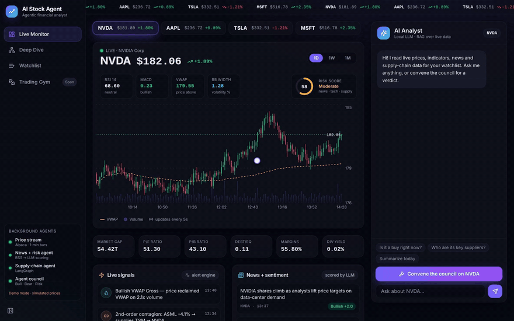

# 📈 Project Oracle — AI Stock Agent

[](docs/ai-stock-agent-demo-voiceover.mp4)

▶️ **[Watch the demo with voice-over (1:45)](docs/ai-stock-agent-demo-voiceover.mp4)** · ✍️ **[Medium article](https://medium.com/@s.parshwa18/stop-staring-at-charts-building-a-real-time-ai-financial-analyst-with-rag-and-quadratic-context-4de44e67b286?postPublishedType=repub)**

**Goal:** a research workspace that watches your companies and their supply chains and tells you,
in seconds, **what changed and the evidence behind it**, in plain language. It reports facts with sources,
and adds one **rule-based investment view** (fair value and BUY / HOLD / SELL) whose formula, inputs and
assumptions are all shown. It does not forecast or trade, and the AI never gives an opinion.

**Facts-first principle:** every figure shown is either (a) reported by the company to the SEC
(XBRL financial data, linked to the filing), (b) a market price with its source and time, or (c) a
standard formula applied to those figures (formula shown). Anything from an unofficial source
(Yahoo Finance) is labelled "not verified".

**Investment view (the one place Oracle goes beyond facts)** — `app/internal/valuation.py`, no AI.
It follows the method of a Managerial Finance team report on Coca-Cola (the capital-budgeting part is left out):

| Step | Formula | Inputs |
|---|---|---|
| Required return (cost of equity) | risk-free rate + adjusted beta × equity risk premium (CAPM) | 10-year Treasury yield; beta from 5 years of monthly returns vs the S&P 500, Blume-adjusted (0.67 × raw + 0.33); ERP 4.5% (assumption, `EQUITY_RISK_PREMIUM`) |
| Dividend discount model | next year's dividend ÷ (required return − growth) | last 12 months of dividends; the company's own dividend growth, capped 2 points below the required return. Used only when the company pays out at least 40% of its profit |
| Historical P/E | average fiscal-year-end P/E × expected EPS | year-end prices; SEC diluted EPS; analysts' next-year EPS estimate (or last reported EPS) |
| Analyst consensus | average 12-month price target | Yahoo Finance (not verified) |
| Fair value | plain average of the methods that apply (at least two) | |
| Rating | **BUY** if price < fair value − 10%, **SELL** if price > fair value + 10%, else **HOLD** | `RATING_BAND` |
| Safeguards | no rating when the highest and lowest method are more than 50% of fair value apart; a "close to the line" note within 2% of a band | `RATING_MAX_SPREAD` |

The same module returns the dividend record (growth, payout, free-cash-flow cover), rule-based risk checks
(each with its threshold) and the report's model portfolio (the stock at 15% plus VTI, VXUS, BND, SGOV, VNQ;
beta, yield, CAPM expected return, fees and a bear-market stress test). A unit test feeds in the report's own
inputs and checks the engine reproduces it: cost of equity 7.16%, fair value ≈ $96.43, HOLD at $95.67,
portfolio beta 0.56. Methods that don't apply are left out (no dividend → no dividend model; foreign filers
reporting in another currency → no rating). It is a formula result for study, not personal investment advice.

**Guardrails enforced in code**
- *Evidence rule for relationships*: a supplier/customer/competitor link is saved only with a quote found
  word-for-word in a filing or article **and** a source link; rows without both are deleted on every start.
- *Accounting checks*: each year's SEC figures must satisfy assets = liabilities + equity, gross profit =
  revenue − cost of revenue, EPS ≈ net income ÷ diluted shares and basic ordering checks; failures get a red badge.
- *Data first, AI second* (`app/internal/fact_answers.py`): questions about reported figures, ratios, price,
  documented relationships or latest headlines are answered straight from SEC data and stored evidence with no
  AI call. Only questions that need reading text (risks, explanations) use one compact AI call (≤5 passages,
  cached 6 h). Briefings are one AI call and are skipped when the underlying data hasn't changed; the
  relationship agent reads each 10-K with the AI once and only sends headlines with relationship words.
- *No AI opinions* (`services/policy.py`): sentences with ratings, recommendations, price targets,
  valuation opinions or predictions are removed from every AI-written answer and daily brief, and logged
  on the AI-quality page. The only rating shown is the formula result above; "buy, hold or sell?" questions
  are routed to it and never to the AI.
- *Plain language* (`app/internal/explain.py`, `glossary.py`): every answer leads with plain sentences, explains
  each term once, compares numbers with the market, peers or the company's past, and ends with
  "what this means / what it doesn't tell you". Built from templates, no AI calls.

Three things this proof of concept demonstrates:
1. **Second-order insight** — a supplier's or customer's move becomes an alert on *your* company, with the
   10-K sentence that proves the link (e.g. a supplier's own filing: "Apple accounted for 22% of net revenue").
2. **Verifiable AI** — answers, specialist briefings and the daily brief cite their sources; every number is
   checked against those sources, and the AI-quality page measures it.
3. **Decision speed** — short, relevant alerts and a daily brief instead of a wall of charts.

| Area | Pages | How it stays honest |
|---|---|---|
| Monitor | Live Monitor, Alerts & brief, Deep Dive, Watchlist | LIVE only when bars arrive; alerts carry their evidence; relationships need a quote found in a filing/article |
| Research | Company Report, Portfolio Lab | Statements straight from SEC XBRL with a badge and filing link per figure; ratios with their formulas; price history and portfolio statistics describe the past only |
| AI | AI Analyst chat, specialist briefing | RAG with [S#] citations; four specialists (financials, market, supply chain, news & filings) summarise what the sources say, with no opinion; number check on every output |
| Trust | AI quality (evals) | Citation rate, clean-number rate, benchmark accuracy on known facts, relationship verification funnel |

All pages follow your **watchlist**: add or remove a ticker and every page re-arranges itself.

## POC scope and known limits

This is a single-user proof of concept, not a production service.

- **Free data**: Alpaca free plan (IEX feed, 30 live symbols), Yahoo Finance via yfinance (unofficial, not licensed
  for commercial use), Google News RSS, SEC EDGAR. A product would use licensed market data.
- **Free AI**: Groq free tier (~1,000 requests/day, enforced by per-purpose budgets) with local Ollama fallback.
- **No accounts**: one shared watchlist; no sign-in, roles or audit log.
- **Local deployment**: Docker Compose on one machine.
- **Relationships are sparse by design**: only links with verifiable evidence are kept, so many real
  relationships simply aren't disclosed in filings and won't appear.

What production would add: licensed data, user accounts and roles, per-user watchlists, an audit trail,
a paid AI tier, CI/CD, monitoring, secrets management and hosted deployment.

## Architecture

See the interactive diagram (request path, one row per background pipeline, RAG answer path, stores).
In short:

- **Gateway** `nginx :80` → **Frontend** (React 18 + Vite) and **API** (FastAPI, `:8000`)
- **Agents** (Docker): `ingestion-price` (Alpaca WebSocket, ≤30 symbols on the free plan), `db-writer`,
  `alert-engine`, `backfill` (once per start), `ingestion-fund`, `news-fetcher` (batched AI sentiment + risk),
  `supply-chain-worker` (10-K → profile → web), `relationship-agent` (headlines), `council-worker`,
  `rag-indexer`, `worker`, `maintenance`
- **Stores**: TiDB Cloud (all durable data incl. `rag_chunks` vectors), Redis (queues, caches, heartbeats)
- **AI**: `services/llm.py` — Groq (free tier, Llama 3.3 70B) with automatic fallback to local Ollama;
  daily request budgets per purpose. Embeddings: Ollama `nomic-embed-text` locally, or `fastembed`
  (in-container, no Ollama) for hosting.

## Quick start

```bash
cp .env.example .env        # fill in DB_URI, ALPACA_KEY/SECRET, GROQ_API_KEY, SEC_USER_AGENT
./start-oracle.command      # or just open the folder in VS Code
```

The start script opens Docker Desktop and Ollama, pulls the models once, rebuilds every container with
the latest code, backfills missing prices and opens http://localhost. API docs: http://localhost:8000/docs.

Fill price gaps on demand: `docker compose run --rm backfill`


## Configuration highlights (`.env`)

| Variable | Meaning |
|---|---|
| `EVENT_MOVE_PCT` | Daily move that triggers a price / partner alert (default 3) |
| `LLM_PROVIDER` | `groq` (free hosted) or `ollama` (local). Groq falls back to Ollama if the key is missing, Groq is down or the budget is spent |
| `GROQ_API_KEY`, `GROQ_MODEL` | Key from console.groq.com; default `llama-3.3-70b-versatile` |
| `LLM_DAILY_BUDGET`, `LLM_BUDGET_*` | Free-tier request caps (total and per purpose: chat, news, relationships, briefings) |
| `RESEARCH_CYCLE_HOURS`, `COUNCIL_REFRESH_HOURS` | How often agents re-run (24 h / 6 h on Groq, 1 h / 1 h on Ollama) |
| `EMBED_PROVIDER` | `ollama` or `fastembed` |
| `ALPACA_MAX_SYMBOLS` | WebSocket symbol cap (30 on the free plan) |
| `SEC_USER_AGENT` | "Your Name your@email.com" — required by SEC EDGAR |
| `ORACLE_ENV`, `ALLOWED_ORIGINS` | `production` hides `/api/debug` and restricts CORS |

## Tests

```bash
python -m unittest discover -s tests -v
```

Covers the finance helpers, financial ratios, the answer number-check, the relationship quote/ticker checks,
the plain-language templates and the valuation/rating engine (33 tests).
The AI-quality page runs a 10-question benchmark (`evals/golden.json`) against the live model.

## Tech stack

FastAPI · pandas/NumPy · yfinance · SEC EDGAR · Alpaca · LangGraph · Groq / Ollama · TiDB Cloud (vector search) ·
Redis + RQ · React 18 · TypeScript · Tailwind · Recharts · Docker Compose · nginx
